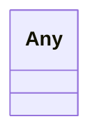

# Class: Any 


_Any value; the slot's ``any_of`` says which._


<div data-search-exclude markdown="1">


URI: [linkml:Any](https://w3id.org/linkml/Any)





<!-- no inheritance hierarchy -->

## Class Properties

| Property | Value |
| --- | --- |
| Class URI | [linkml:Any](https://w3id.org/linkml/Any) |


## Slots

| Name | Cardinality and Range | Description | Inheritance |
| ---  | --- | --- | --- |


## Usages

| used by | used in | type | used |
| ---  | --- | --- | --- |
| [ControlVariable](ControlVariable.md) | [value](value.md) | range | [Any](Any.md) |
| [ControlVariable](ControlVariable.md) | [shape](shape.md) | range | [Any](Any.md) |
| [MagneticElement](MagneticElement.md) | [entrance_edge_angle](entrance_edge_angle.md) | range | [Any](Any.md) |
| [MagneticElement](MagneticElement.md) | [exit_edge_angle](exit_edge_angle.md) | range | [Any](Any.md) |
| [DipoleMagnet](DipoleMagnet.md) | [entrance_edge_angle](entrance_edge_angle.md) | range | [Any](Any.md) |
| [DipoleMagnet](DipoleMagnet.md) | [exit_edge_angle](exit_edge_angle.md) | range | [Any](Any.md) |
| [QuadrupoleMagnet](QuadrupoleMagnet.md) | [entrance_edge_angle](entrance_edge_angle.md) | range | [Any](Any.md) |
| [QuadrupoleMagnet](QuadrupoleMagnet.md) | [exit_edge_angle](exit_edge_angle.md) | range | [Any](Any.md) |
| [SextupoleMagnet](SextupoleMagnet.md) | [entrance_edge_angle](entrance_edge_angle.md) | range | [Any](Any.md) |
| [SextupoleMagnet](SextupoleMagnet.md) | [exit_edge_angle](exit_edge_angle.md) | range | [Any](Any.md) |
| [OctupoleMagnet](OctupoleMagnet.md) | [entrance_edge_angle](entrance_edge_angle.md) | range | [Any](Any.md) |
| [OctupoleMagnet](OctupoleMagnet.md) | [exit_edge_angle](exit_edge_angle.md) | range | [Any](Any.md) |
| [CorrectorMagnet](CorrectorMagnet.md) | [entrance_edge_angle](entrance_edge_angle.md) | range | [Any](Any.md) |
| [CorrectorMagnet](CorrectorMagnet.md) | [exit_edge_angle](exit_edge_angle.md) | range | [Any](Any.md) |
| [CombinedSolenoidQuadrupoleMagnet](CombinedSolenoidQuadrupoleMagnet.md) | [entrance_edge_angle](entrance_edge_angle.md) | range | [Any](Any.md) |
| [CombinedSolenoidQuadrupoleMagnet](CombinedSolenoidQuadrupoleMagnet.md) | [exit_edge_angle](exit_edge_angle.md) | range | [Any](Any.md) |


## Identifier and Mapping Information


### Schema Source


* from schema: https://w3id.org/laura/schema


## Mappings

| Mapping Type | Mapped Value |
| ---  | ---  |
| self | linkml:Any |
| native | laura:Any |


## LinkML Source

<!-- TODO: investigate https://stackoverflow.com/questions/37606292/how-to-create-tabbed-code-blocks-in-mkdocs-or-sphinx -->

### Direct

<details>
```yaml
name: Any
description: Any value; the slot's ``any_of`` says which.
from_schema: https://w3id.org/laura/schema
class_uri: linkml:Any

```
</details>

### Induced

<details>
```yaml
name: Any
description: Any value; the slot's ``any_of`` says which.
from_schema: https://w3id.org/laura/schema
class_uri: linkml:Any

```
</details></div>